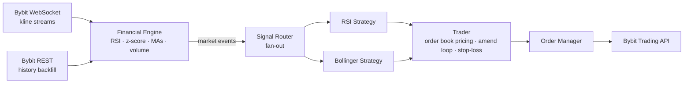

# crypbot

An event-driven, automated crypto trading system written in Go. It streams real-time market data from **Bybit**, computes technical indicators on the fly for ~100 USDT spot pairs, and runs multiple trading strategies in parallel, each with its own sub-account, order lifecycle and risk controls.

Built as a side project together with a quant partner: I designed and built the engineering platform (data ingestion, indicator engine, order execution, deployment); my partner led strategy research and backtesting. It traded live with real capital.

## Highlights

- **Real-time market data pipeline**: WebSocket kline streams for 100+ symbols, sharded across connections, with keep-alive pings and automatic reconnection. Historical klines are backfilled over REST on startup so indicators are warm before trading begins.
- **Streaming indicator engine**: maintains per-symbol RSI (closed and live candle), z-score / Bollinger bands, 50/100-period moving averages on a higher timeframe and median 24h traded volume, with TTL caching for the more expensive calculations.
- **Pluggable strategies**: strategies implement a common interface and are enabled from YAML config. A fan-out router broadcasts market events to each strategy over its own buffered channel, so a slow strategy cannot block the data feed.
  - *RSI mean reversion*: buys deeply oversold coins in an uptrend (MA50 > MA100) with sufficient liquidity, exits on RSI recovery.
  - *Bollinger / z-score*: enters and exits on statistical deviation from the 20-period mean.
- **Smart order execution**: limit orders are priced from the live order book (best bid/ask vs. last close, rounded to the instrument's tick precision), then continuously monitored and amended while the entry signal is still valid. Unfilled exits fall back to a market order after a timeout. Every entry carries an exchange-side stop-loss.
- **Operational robustness**: context-based graceful shutdown, config validation at startup, separate testnet/production configs, Dockerised build and a one-command deploy script with health checks and Telegram alerting.

## Architecture




## Tech stack

Go · Python, pandas, Jupyter for research · Docker, Bash, Linux VPS, Telegram monitoring

## Project layout

```
cmd/crypbot/          entry point and wiring
config/               typed, validated YAML configuration
internal/financial/   indicator engine
internal/router/      market-event fan-out
internal/strategy/    RSI and Bollinger strategies
internal/trader/      order pricing, monitoring and amendment
internal/order/       order lifecycle management
internal/exchange/    exchange interfaces + Bybit implementation
pkg/websocket/        reconnecting WebSocket client
docs/                 strategy logic and research notebooks
```

## Running it

Configuration (API keys, symbols, strategy parameters) lives in `config/config_test.yaml` for testnet and `config/config.yaml` for production. Neither is committed.

```bash
go run ./cmd/crypbot                          # testnet config
ENVIRONMENT=production go run ./cmd/crypbot   # production config
```
